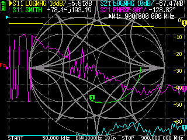

# ST7789P3 panel detection

Proposed release note: recognize the ST7789P3 LCD ID on NanoVNA-H boards. These
panels previously fell back to the ILI9341 initialization sequence, causing a
sideways display and distorted screenshot readback on the tested NanoVNA-H
hw 3.7_ZK (STM32F072, F072-ZK firmware).

The additional ID and use of the existing ST7789 sequence follow
[hugen79/NanoVNA-H 1.2.50](https://github.com/hugen79/NanoVNA-H/blob/816495ebc8ca022149787ec2f9e058d6ce3bcb3b/lcd.c) and
[DiSlord/NanoVNA-D](https://github.com/DiSlord/NanoVNA-D/blob/master/lcd.c).
No global rotation override or manual read-speed change is needed: the existing
ST7789 path already selects its correct initialization and slower read speed.
F303 uses a separate ST7796S driver and is unchanged.

Hardware evidence from November 17, 2026: a NanoVNA-H hw 3.7_ZK returned startup
RDDID 0x40C0D9FF, decoded as 0x8181B3. Automatic selection of the ST7789 driver
produced readable 153600-byte captures; the user confirmed the physical display
was upright and touch selections aligned. This evidence was collected with a
temporary diagnostic image before removing diagnostic commands. The clean
two-line detection change was then built, flashed and readback-verified, and
again returned a readable 153600-byte capture after reboot. The saved-data
region matched the original full-flash backup before starting each image.

After the clean firmware was handed over for calibration and normal measurement
testing, the operator reported on November 17, 2026: "testing looks good".
This records a successful user bench check on that hw 3.7_ZK unit; test frequencies,
standards, measured values and tolerances were not recorded, so it is not a
quantified RF accuracy validation or coverage of other hardware variants.

The following USB capture was collected from the clean fixed firmware before
the user's calibration/testing session; it demonstrates corrected readback,
not a calibrated RF reference measurement.

The host regression compiles the production detector and checks the P3 ID,
existing ST7789V ID, fallback and neighboring nonmatching IDs. Physical behavior
of other panel types still needs upstream coverage. This does not infer LCD
type from the ZK RF profile or alter saved calibration/configuration layouts.
